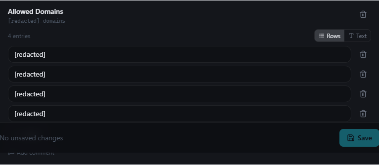
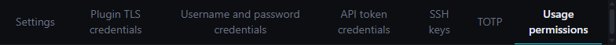

# Jarvis in production — ZeroClaw architecture and evidence

Jarvis is our production ZeroClaw instance on a Linux VM. We use it for day-to-day operational work while developing these features. Production use gives us feedback on configuration and actual workflows. When we find a defect, we reproduce it, correct it and verify the change. Our integrated deployment includes work from multiple PRs, so each evidence item should identify whether it came from production, an exact PR revision with simulated data, or a local test.

## Upstream scope and the production build

Reviewers requested smaller upstream changes so they could review the core behavior independently. We narrowed those PRs and preserved the extended implementation in separate draft PRs, including [#12517](https://github.com/zeroclaw-labs/zeroclaw/pull/12517), [#12481](https://github.com/zeroclaw-labs/zeroclaw/pull/12481) and [#12482](https://github.com/zeroclaw-labs/zeroclaw/pull/12482), pending the outcome of [RFC #12422](https://github.com/zeroclaw-labs/zeroclaw/issues/12422). Jarvis combines the reduced and extended PRs in a single production deployment, so operators can continue using the complete workflows while upstream review proceeds. Production results describe that integrated build and indicate which exact PR revisions were tested separately.

## Evidence available

| Workflow | Evidence and result |
| --- | --- |
| Headless browser, GitHub | Username/password and a separate TOTP reference completed the GitHub login in an isolated browser. The authenticated account menu appeared. The OTP field required a generic selector override. [PR evidence](https://github.com/zeroclaw-labs/zeroclaw/pull/12596#issuecomment-7057756446) |
| Headless browser, Roundcube with Keycloak | Username → TOTP → password worked with distinct vault references. Roundcube logged the OIDC callback and HTTP 200 on the authenticated mail route. The one-time operator exception was removed. [PR evidence](https://github.com/zeroclaw-labs/zeroclaw/pull/12596#issuecomment-7057538446) |
| Browser without TOTP, simulated site | Headless Chromium submitted synthetic username/password to a local fixture and reached its signed-in page. A cross-origin submission was refused. [PR evidence](https://github.com/zeroclaw-labs/zeroclaw/pull/12596#issuecomment-7057538446) |
| HTTP credentials and grants | Desktop and narrow captures show create, deny by default, grant, revoke, replacement and deletion. The real gateway regressions cover same-origin and changed-origin rotation and generic write protection. The visual catalog is simulated. [HTTP evidence](https://github.com/zeroclaw-labs/zeroclaw/pull/12408#issuecomment-7058295939) [Gateway evidence](https://github.com/zeroclaw-labs/zeroclaw/pull/12408#issuecomment-7058381320) |
| API keys and Token authorization | Desktop and narrow captures show explicit grant/revoke and the Token header preserved on replacement. [Token evidence](https://github.com/zeroclaw-labs/zeroclaw/pull/12490#issuecomment-7058296317) |
| OpenBao and plugin TLS | Exact-revision UI captures show managed creation or linking in OpenBao and the TLS credential editor. These captures use synthetic catalog data. [OpenBao](https://github.com/zeroclaw-labs/zeroclaw/pull/12481#issuecomment-7058431965) [TLS](https://github.com/zeroclaw-labs/zeroclaw/pull/12408#issuecomment-7058349445) |
| Managed SSH | On Jarvis after reboot, the Rust broker executed a read-only boot ID query against the SIEM. OpenSSH lifecycle testing also verified that normal task closure and forced helper death left no live master. [SSH lifecycle evidence](https://github.com/zeroclaw-labs/zeroclaw/pull/11869#issuecomment-6880479690) |
| Browser voice | The operator tested natural speech, automatic submission and audible replies in Chrome and Edge. OIDC was also tested live. The current voice PR records the contention regression and automated results. Audio recording and current prompt screenshots are pending. [Paired browser voice](https://github.com/zeroclaw-labs/zeroclaw/pull/12269) [OIDC voice](https://github.com/zeroclaw-labs/zeroclaw/pull/12459) |

## Prompts for the illustrated evidence

- SSH: “Use managed SSH to read the target host’s boot ID. Show the result.” Use an approved host and redact the boot ID in public materials.
- Browser: “Sign in using the specified username/password alias and use the separate TOTP alias if requested. Confirm authenticated UI, then close the test session.” Use one approved GitHub test session and omit the account name.
- Webmail: use existing authenticated test evidence. Jarvis’s standing send-only policy prohibits reopening webmail without a new explicit exception.
- Simulated site: use synthetic aliases and capture both the authenticated result and refusal of a cross-origin destination.
- Voice: dictate a short neutral question, show the transcript and single automatic submit, and record the spoken reply. Use a fresh user-provided or explicitly authorized audio sample.

## Production configuration captures

The browser destination list and the credential grant are independent controls. Allowing a destination in the browser does not grant use of a secret. Each alias needs a grant for the browser and the matching HTTPS origin. The GitHub test initially stopped at the browser allowlist; after the operator granted the destination, the separate password and TOTP aliases worked on that origin. The simulated cross-origin test checks rejection before a credential is filled or submitted.

In the Roundcube test, Keycloak is the **OIDC provider of the target application**. That test is independent of the OIDC session used by an operator to access the Jarvis dashboard. The simulated browser-form tests use a separate controlled site.

## Review request and remaining evidence

The integrated production experience is why we ask reviewers to consider the complete architecture and retain the full feature scope across the PR stack. Smaller review units can be merged as their dependencies and governance allow.

This report links independently verified results and labels simulated captures. It does not yet include original prompt/result screenshots for every workflow, the live detail screens for every Secrets form or user permission, or recordings of dictation and narration. No real operator audio is attached.